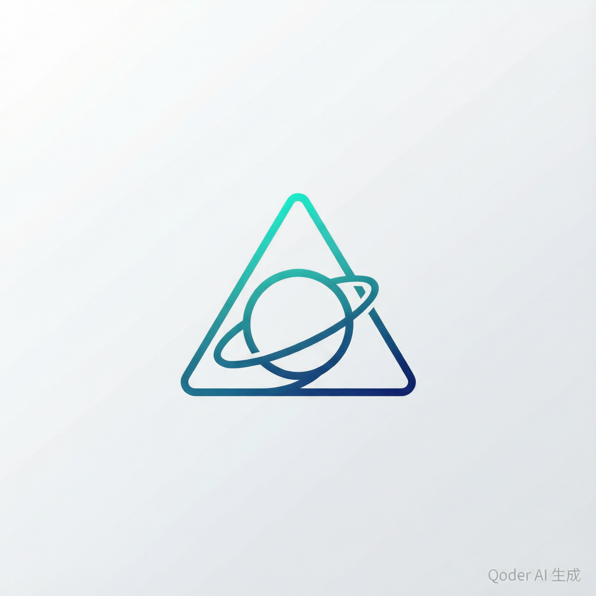

# 星云商城（Nebula Stationery）

> 一个基于 Vue 3 + Spring Boot 3 的文具店商城系统

---

## 项目简介

星云商城是一个完整的电商系统，包含前台购物和后台管理功能。顾客可以浏览商品、加入购物车、下单付款、确认收货并评价；管理员可以管理商品和订单。

---

## 技术栈

### 前端
- Vue 3 + Vite + Axios
- Vue Router + Pinia
- 手写 CSS（参考 tonymoly 极简风格）

### 后端
- Java 17 + Spring Boot 3
- Spring Security + JWT
- MyBatis + MySQL 8

---

## 项目结构

```
nebula-stationery/
├── fronted/              # Vue 3 前端
├── backend/              # Spring Boot 后端
├── sql/                  # 建表语句 + 初始化数据
├── 素材/                 # 项目相关文件（logo 等）
├── docs-framework/       # 规格说明文档
│   ├── 01_PRD.md         # 产品需求文档
│   ├── 02_Architecture.md # 架构说明
│   ├── 03_Database.md    # 数据库设计
│   ├── 04_API.md         # 接口契约
│   └── flow/             # 业务流程图
│       ├── 全局 flow.md
│       ├── User_Auth.md
│       └── Dashboard.md
└── README.md
```

---

## 快速开始

### 1. 初始化数据库

```bash
mysql -u root -p sky_take_out < sql/schema.sql
mysql -u root -p sky_take_out < sql/init-data.sql
```

### 2. 启动后端

```bash
cd backend
mvn spring-boot:run
```

后端运行在：http://localhost:8080

### 3. 启动前端

```bash
cd fronted
npm install
npm run dev
```

前端运行在：http://localhost:5173

---

## 用户角色

| 角色 | 说明 | 核心权限 |
| --- | --- | --- |
| 游客 | 未登录 | 浏览首页、分类、商品详情 |
| 普通用户 | 自主注册 | 登录、加购、下单、付款、订单管理、评价 |
| 管理员 | 初始化数据固定 | 登录后台、订单管理、商品管理 |

---

## 核心功能

### 前台
- 首页（分类入口 + 推荐商品）
- 商品分类（两级分类）
- 商品详情（含评价）
- 注册与登录（JWT 认证）
- 购物车
- 下单与付款（模拟）
- 我的订单
- 确认收货与评价

### 后台
- 订单管理（列表 + 详情 + 标记发货）
- 商品管理（新增/编辑 + 上下架）

---

## 文档

- [产品需求文档](docs-framework/01_PRD.md)
- [架构说明](docs-framework/02_Architecture.md)
- [数据库设计](docs-framework/03_Database.md)
- [接口契约](docs-framework/04_API.md)
- [业务流程图](docs-framework/flow/)

---

## Logo



---

## 许可证

MIT
