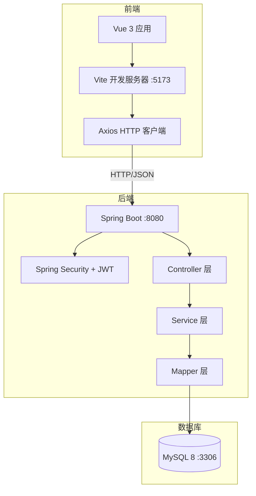
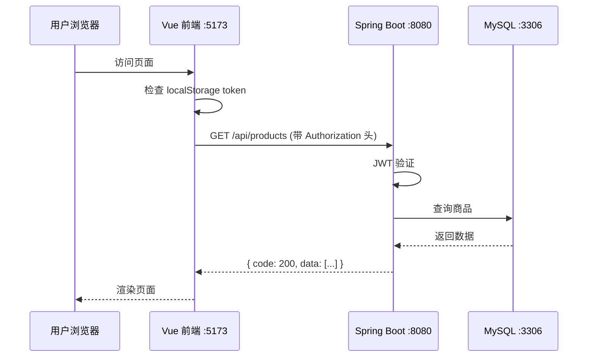
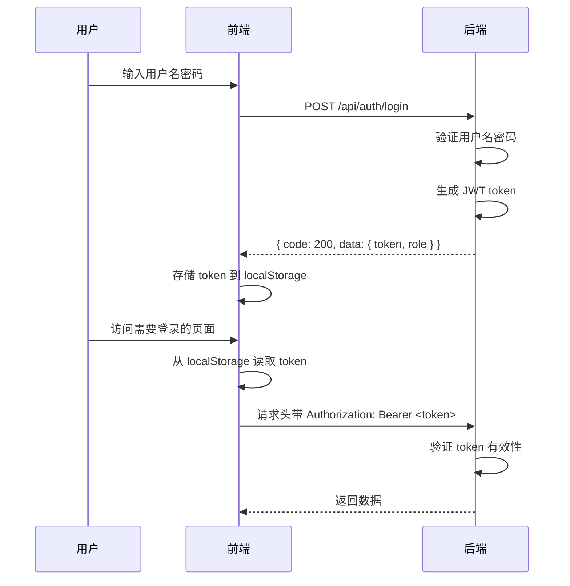

# 星云商城（Nebula Stationery）架构说明

> 版本：1.0 | 更新日期：2026-10-29

---

## 一、技术栈选型

### 1.1 前端
| 技术 | 版本 | 用途 |
| --- | --- | --- |
| Vue 3 | 3.x | 前端框架（Composition API） |
| Vite | 5.x | 构建工具 + 开发服务器 |
| Axios | 1.x | HTTP 请求库 |
| Vue Router | 4.x | 前端路由 |
| Pinia | 2.x | 状态管理（登录态、购物车） |
| 手写 CSS | - | 样式（参考 tonymoly 极简风格） |

### 1.2 后端
| 技术 | 版本 | 用途 |
| --- | --- | --- |
| Java | 17 | 编程语言 |
| Spring Boot | 3.x | 应用框架 |
| Spring Security | 6.x | 安全框架（JWT 集成） |
| MyBatis | 3.5.x | ORM 框架 |
| MyBatis-Plus | 3.5.x（可选） | MyBatis 增强工具 |
| JWT | 0.12.x | 身份认证（jjwt 库） |
| BCrypt | - | 密码加密 |
| Maven | 3.9.x | 构建工具 |

### 1.3 数据库
| 技术 | 版本 | 用途 |
| --- | --- | --- |
| MySQL | 8.x | 关系型数据库 |
| 连接池 | HikariCP（Spring Boot 默认） | 数据库连接池 |

---

## 二、系统架构

### 2.1 整体架构图



### 2.2 前后端交互流程



---

## 三、后端分层架构

### 3.1 包结构

```
com.nebula.stationery
├── config/              # 配置类（Security、JWT、CORS）
├── controller/          # 控制器层（接收请求、参数校验）
── service/             # 业务逻辑层（核心规则）
├── mapper/              # 数据访问层（MyBatis 接口）
── entity/              # 实体类（对应数据库表）
├── dto/                 # 数据传输对象（请求/响应）
├── vo/                  # 视图对象（返回给前端）
├── common/              # 公共类（统一响应、异常、常量）
└── utils/               # 工具类（JWT、BCrypt）
```

### 3.2 分层职责

| 层 | 职责 | 示例 |
| --- | --- | --- |
| **Controller** | 接收 HTTP 请求、参数校验、调用 Service | `ProductController.list()` |
| **Service** | 业务规则、事务管理、调用 Mapper | `OrderService.createOrder()` |
| **Mapper** | 数据库 CRUD 操作 | `ProductMapper.selectById()` |

---

## 四、认证与授权

### 4.1 JWT 认证流程



### 4.2 角色权限控制

| 角色 | 前台访问 | 后台访问 | 下单 | 评价 |
| --- | --- | --- | --- | --- |
| 游客 | ✅ 浏览 | ❌ | ❌ | ❌ |
| 普通用户 | ✅ | ❌ | ✅ | ✅ |
| 管理员 | ✅ 浏览 | ✅ 管理 | ❌ | ❌ |

---

## 五、统一响应结构

### 5.1 响应格式

```json
{
  "code": 200,
  "message": "success",
  "data": { ... }
}
```

### 5.2 状态码规范

| 状态码 | 含义 | 使用场景 |
| --- | --- | --- |
| 200 | 成功 | 正常返回数据 |
| 400 | 参数错误/业务规则违反 | 库存不足、重复评价、用户名已存在 |
| 401 | 未登录 | 未携带 token 或 token 过期 |
| 403 | 无权限 | 普通用户访问后台接口 |
| 500 | 服务端异常 | 系统内部错误 |

---

## 六、跨域处理

### 6.1 开发环境
使用 Vite proxy 转发 `/api` 到后端：

```javascript
// vite.config.js
export default {
  server: {
    proxy: {
      '/api': {
        target: 'http://localhost:8080',
        changeOrigin: true
      }
    }
  }
}
```

### 6.2 生产环境
后端配置 CORS 允许前端域名访问。

---

## 七、事务管理

### 7.1 关键事务场景

| 场景 | 事务要求 |
| --- | --- |
| 下单 | 扣库存 + 写订单 + 写订单明细（原子操作） |
| 取消订单 | 回补库存 + 更新订单状态（原子操作） |
| 确认收货 | 更新订单状态（原子操作） |

### 7.2 实现方式
使用 Spring `@Transactional` 注解，任一失败全部回滚。

---

## 八、安全设计

### 8.1 密码存储
- 使用 BCrypt 加密，不存明文
- 注册时加密存储，登录时比对

### 8.2 接口安全
- 所有需要登录的接口必须携带 JWT token
- 后端校验 token 有效性，不依赖前端拦截
- 普通用户访问后台接口返回 403

### 8.3 数据隔离
- 用户只能看自己的订单
- 即使用户修改请求参数（如订单号），也不能看到别人的数据

---

## 九、部署说明

### 9.1 开发环境启动

```bash
# 1. 初始化数据库
mysql -u root -p sky_take_out < sql/init.sql

# 2. 启动后端
cd backend
mvn spring-boot:run

# 3. 启动前端
cd fronted
npm install
npm run dev
```

### 9.2 访问地址
- 前端：http://localhost:5173
- 后端：http://localhost:8080
- 数据库：localhost:3306/sky_take_out

---

## 十、项目结构

```
nebula-stationery/
├── fronted/              # Vue 3 前端
│   ├── src/
│   │   ├── views/        # 页面组件
│   │   ├── components/   # 公共组件
│   │   ├── api/          # Axios 封装
│   │   ├── store/        # Pinia 状态管理
│   │   ├── router/       # 路由配置
│   │   └── utils/        # 工具函数
│   └── package.json
├── backend/              # Spring Boot 后端
│   ├── src/main/java/
│   │   └── com/nebula/stationery/
│   ├── src/main/resources/
│   │   ├── application.yml
│   │   └── mapper/       # MyBatis XML
│   └── pom.xml
├── sql/                  # 建表语句 + 初始化数据
│   ├── schema.sql
│   └── init-data.sql
├── 素材/                 # 项目相关文件
├── docs-framework/       # 规格说明文档
│   ├── 01_PRD.md
│   ├── 02_Architecture.md
│   ├── 03_Database.md
│   ├── 04_API.md
│   └── flow/
└── README.md
```
