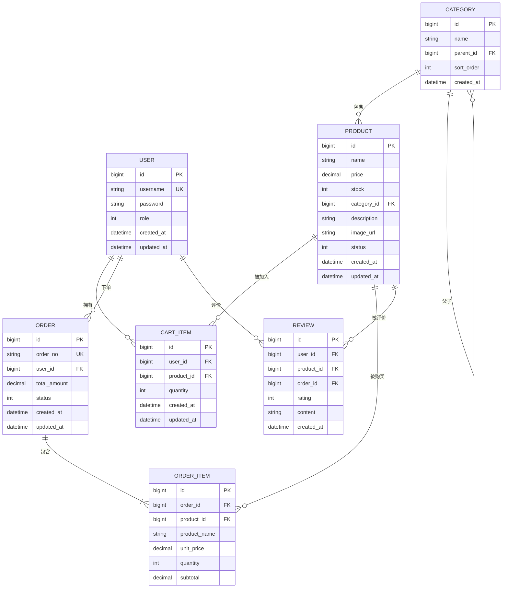

# 星云商城（Nebula Stationery）数据库设计

> 版本：1.0 | 更新日期：2026-10-29

---

## 一、ER 图

---

## 二、表结构详细说明

### 2.1 user（用户表）

| 字段 | 类型 | 约束 | 说明 |
| --- | --- | --- | --- |
| id | BIGINT | PK, AUTO_INCREMENT | 主键 |
| username | VARCHAR(50) | UNIQUE, NOT NULL | 用户名（唯一） |
| password | VARCHAR(100) | NOT NULL | 密码（BCrypt 加密） |
| role | TINYINT | NOT NULL, DEFAULT 0 | 角色：0-普通用户，1-管理员 |
| created_at | DATETIME | NOT NULL, DEFAULT CURRENT_TIMESTAMP | 创建时间 |
| updated_at | DATETIME | NOT NULL, DEFAULT CURRENT_TIMESTAMP ON UPDATE CURRENT_TIMESTAMP | 更新时间 |

**索引**：
- `idx_username` (username)

---

### 2.2 category（分类表）

| 字段 | 类型 | 约束 | 说明 |
| --- | --- | --- | --- |
| id | BIGINT | PK, AUTO_INCREMENT | 主键 |
| name | VARCHAR(50) | NOT NULL | 分类名称 |
| parent_id | BIGINT | DEFAULT NULL | 父分类 ID（NULL 表示一级分类） |
| sort_order | INT | DEFAULT 0 | 排序权重（越小越靠前） |
| created_at | DATETIME | NOT NULL, DEFAULT CURRENT_TIMESTAMP | 创建时间 |

**索引**：
- `idx_parent_id` (parent_id)

---

### 2.3 product（商品表）

| 字段 | 类型 | 约束 | 说明 |
| --- | --- | --- | --- |
| id | BIGINT | PK, AUTO_INCREMENT | 主键 |
| name | VARCHAR(100) | NOT NULL | 商品名称 |
| price | DECIMAL(10,2) | NOT NULL | 价格（元） |
| stock | INT | NOT NULL, DEFAULT 0 | 库存（不允许负数） |
| category_id | BIGINT | NOT NULL | 所属分类 ID（二级分类） |
| description | TEXT | DEFAULT NULL | 商品描述 |
| image_url | VARCHAR(200) | DEFAULT NULL | 图片地址 |
| status | TINYINT | NOT NULL, DEFAULT 1 | 状态：0-下架，1-上架 |
| created_at | DATETIME | NOT NULL, DEFAULT CURRENT_TIMESTAMP | 创建时间 |
| updated_at | DATETIME | NOT NULL, DEFAULT CURRENT_TIMESTAMP ON UPDATE CURRENT_TIMESTAMP | 更新时间 |

**索引**：
- `idx_category_id` (category_id)
- `idx_status` (status)

**约束**：
- `CHECK (stock >= 0)` 库存不允许负数

---

### 2.4 cart_item（购物车项表）

| 字段 | 类型 | 约束 | 说明 |
| --- | --- | --- | --- |
| id | BIGINT | PK, AUTO_INCREMENT | 主键 |
| user_id | BIGINT | NOT NULL | 用户 ID |
| product_id | BIGINT | NOT NULL | 商品 ID |
| quantity | INT | NOT NULL, DEFAULT 1 | 数量 |
| created_at | DATETIME | NOT NULL, DEFAULT CURRENT_TIMESTAMP | 创建时间 |
| updated_at | DATETIME | NOT NULL, DEFAULT CURRENT_TIMESTAMP ON UPDATE CURRENT_TIMESTAMP | 更新时间 |

**索引**：
- `idx_user_id` (user_id)
- `idx_product_id` (product_id)
- `uk_user_product` (user_id, product_id) UNIQUE — 同一用户同一商品只有一条记录

**约束**：
- `CHECK (quantity > 0)` 数量必须大于 0

---

### 2.5 order（订单主表）

| 字段 | 类型 | 约束 | 说明 |
| --- | --- | --- | --- |
| id | BIGINT | PK, AUTO_INCREMENT | 主键 |
| order_no | VARCHAR(50) | UNIQUE, NOT NULL | 订单号（唯一） |
| user_id | BIGINT | NOT NULL | 用户 ID |
| total_amount | DECIMAL(10,2) | NOT NULL | 订单总金额（服务端计算） |
| status | TINYINT | NOT NULL, DEFAULT 0 | 状态：0-待支付，1-已支付，2-已发货，3-已完成，4-已取消 |
| created_at | DATETIME | NOT NULL, DEFAULT CURRENT_TIMESTAMP | 创建时间 |
| updated_at | DATETIME | NOT NULL, DEFAULT CURRENT_TIMESTAMP ON UPDATE CURRENT_TIMESTAMP | 更新时间 |

**索引**：
- `idx_user_id` (user_id)
- `idx_status` (status)
- `idx_order_no` (order_no)

---

### 2.6 order_item（订单明细表）

| 字段 | 类型 | 约束 | 说明 |
| --- | --- | --- | --- |
| id | BIGINT | PK, AUTO_INCREMENT | 主键 |
| order_id | BIGINT | NOT NULL | 订单 ID |
| product_id | BIGINT | NOT NULL | 商品 ID |
| product_name | VARCHAR(100) | NOT NULL | 商品名称（快照） |
| unit_price | DECIMAL(10,2) | NOT NULL | 单价（快照，下单时的价格） |
| quantity | INT | NOT NULL | 数量 |
| subtotal | DECIMAL(10,2) | NOT NULL | 小计（unit_price × quantity） |

**索引**：
- `idx_order_id` (order_id)

**说明**：
- product_name 和 unit_price 是快照数据，记录下单时的商品信息
- 后续商品改价不影响历史订单

---

### 2.7 review（评价表）

| 字段 | 类型 | 约束 | 说明 |
| --- | --- | --- | --- |
| id | BIGINT | PK, AUTO_INCREMENT | 主键 |
| user_id | BIGINT | NOT NULL | 用户 ID |
| product_id | BIGINT | NOT NULL | 商品 ID |
| order_id | BIGINT | NOT NULL | 订单 ID |
| rating | TINYINT | NOT NULL | 评分（1-5 星） |
| content | VARCHAR(500) | DEFAULT NULL | 评价文字 |
| created_at | DATETIME | NOT NULL, DEFAULT CURRENT_TIMESTAMP | 创建时间 |

**索引**：
- `idx_user_id` (user_id)
- `idx_product_id` (product_id)
- `idx_order_id` (order_id)
- `uk_user_product_order` (user_id, product_id, order_id) UNIQUE — 同一订单同一商品只能评一次

**约束**：
- `CHECK (rating BETWEEN 1 AND 5)` 评分范围 1-5

---

## 三、初始化数据要求

### 3.1 用户数据
- 普通用户 2 个（role = 0）
- 管理员 1 个（role = 1）

### 3.2 分类数据
- 一级分类不少于 3 个
- 每个一级分类下至少 1 个二级分类

### 3.3 商品数据
- 商品不少于 12 件
- 其中 2 件下架（status = 0）
- 其中 1 件库存为 0（stock = 0）

### 3.4 订单数据
- 不同状态的订单各 1 条：
  - 待支付（status = 0）
  - 已支付（status = 1）
  - 已发货（status = 2）
  - 已完成（status = 3）
  - 已取消（status = 4）

---

## 四、关键业务约束

### 4.1 库存约束
- 库存字段 `stock` 不允许负数
- 下单时检查库存是否充足
- 扣库存和写订单在同一事务中

### 4.2 订单金额约束
- 订单总金额由服务端根据订单明细计算
- 前端传来的金额不采信
- 订单明细中的单价是快照数据

### 4.3 评价约束
- 只有已完成订单（status = 3）的商品能被评价
- 同一订单同一商品只能评价一次（唯一索引保证）

### 4.4 购物车约束
- 同一用户同一商品只能有一条购物车记录
- 重复加购只增加数量
- 数量必须大于 0

---

## 五、建表语句位置

建表语句和初始化数据存放在：
- `sql/schema.sql` — 建表语句
- `sql/init-data.sql` — 初始化数据
