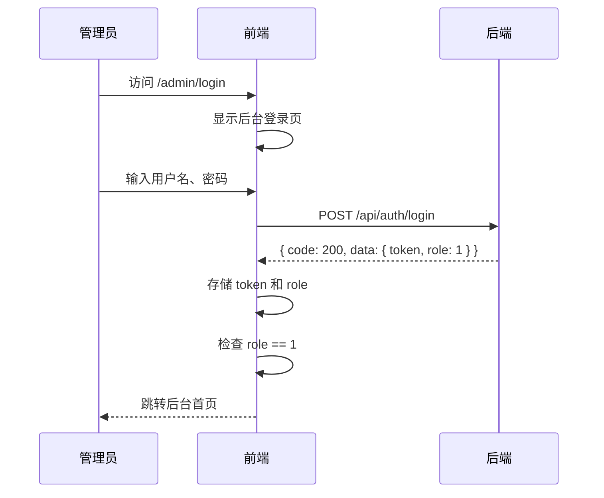
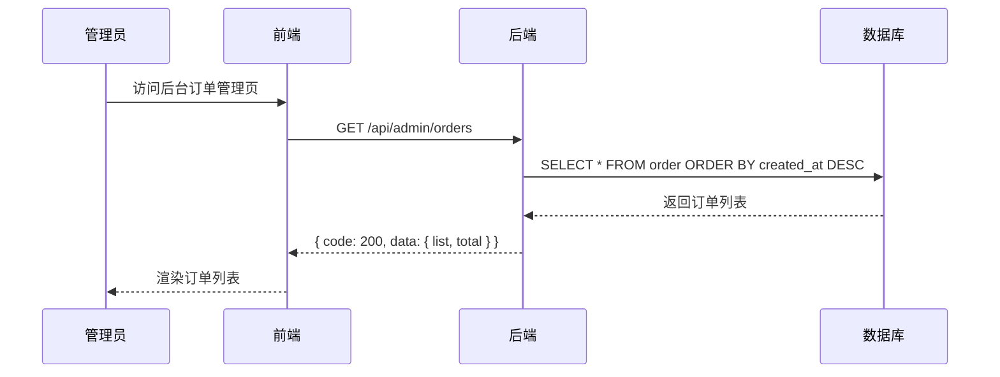
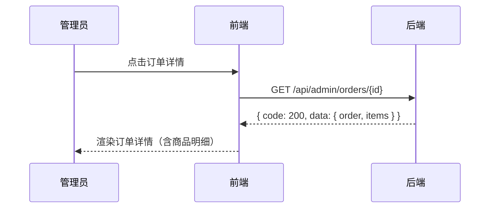
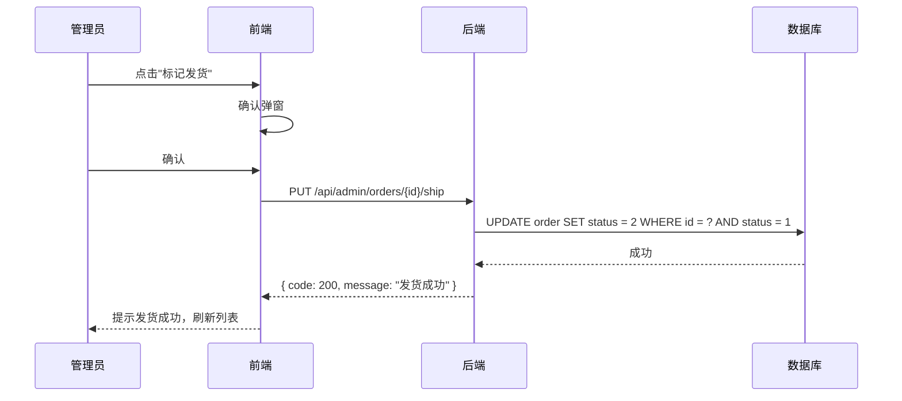
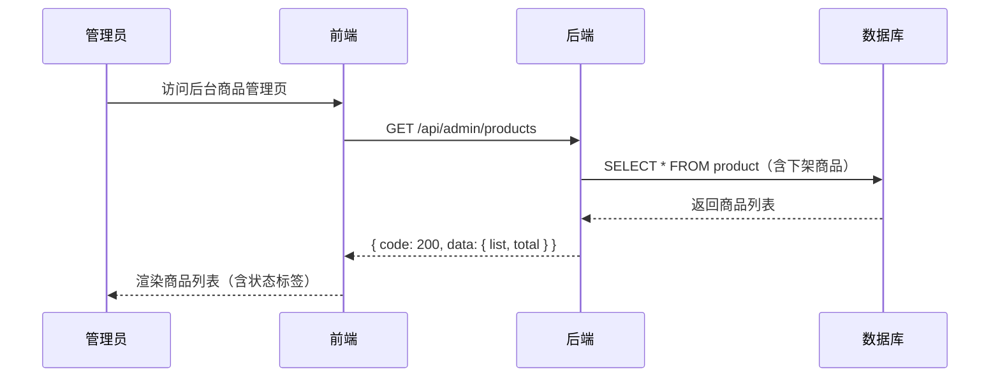
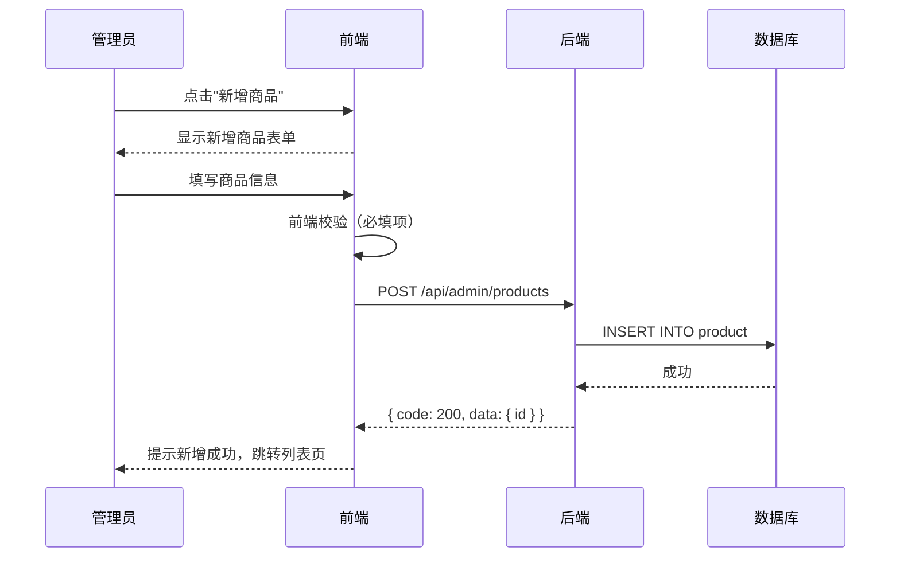
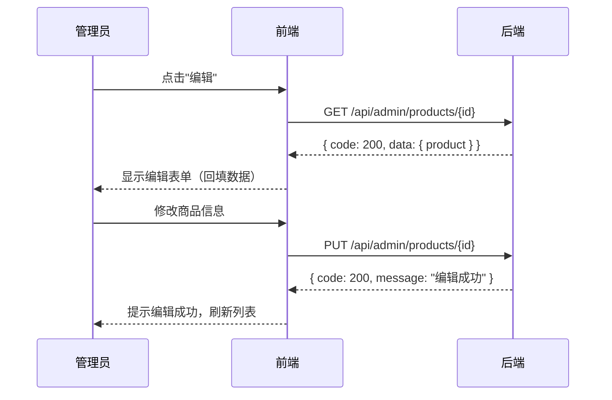
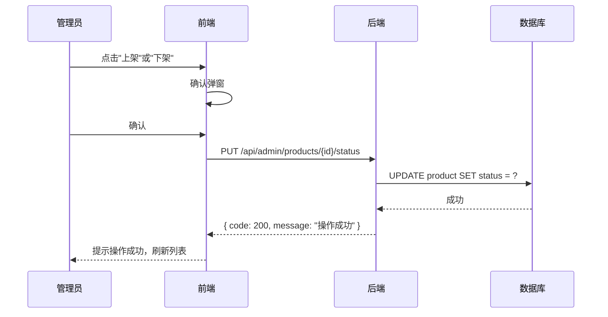
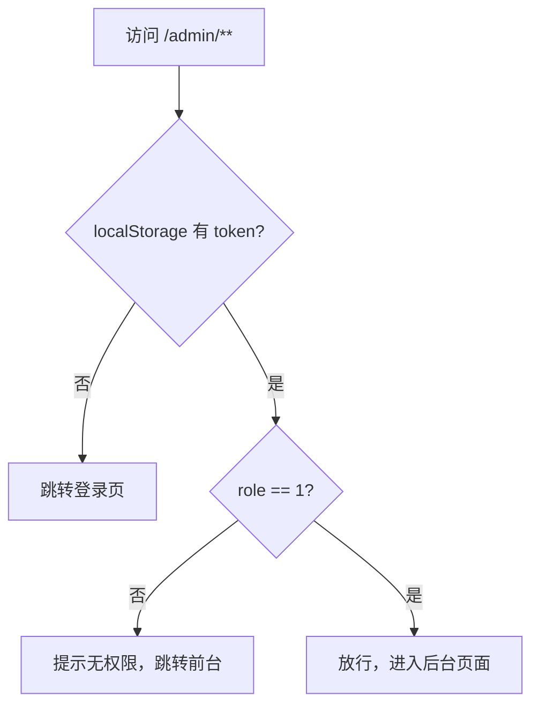
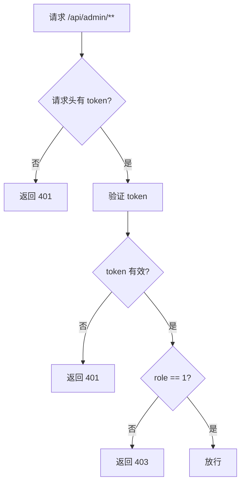

# 后台管理模块

> 版本：1.0 | 更新日期：2026-10-29

---

## 一、模块概述

本模块负责管理员登录后的后台管理功能，包括订单管理和商品管理。

**访问入口**：`/admin` 路由前缀

**权限要求**：仅管理员（role = 1）可访问

---

## 二、后台登录

### 2.1 流程图



### 2.2 业务规则

| 规则 | 说明 |
| --- | --- |
| 登录接口 | 复用普通用户登录接口 |
| 角色判断 | 前端根据 role 决定跳转前台还是后台 |
| 管理员不能下单 | 后台无购物车、下单功能 |

---

## 三、订单管理

### 3.1 订单列表

#### 流程图



#### 筛选功能

| 筛选条件 | 说明 |
| --- | --- |
| 订单状态 | 待支付、已支付、已发货、已完成、已取消 |
| 订单号 | 模糊搜索 |
| 时间范围 | 创建时间范围 |

#### 列表字段

| 字段 | 说明 |
| --- | --- |
| 订单号 | order_no |
| 用户名 | 关联 user 表 |
| 订单金额 | total_amount |
| 订单状态 | status（带状态标签） |
| 创建时间 | created_at |
| 操作 | 查看详情、标记发货（仅已支付） |

---

### 3.2 订单详情

#### 流程图



#### 详情内容

| 区域 | 内容 |
| --- | --- |
| 订单信息 | 订单号、用户名、订单金额、状态、创建时间 |
| 商品明细 | 商品名称、单价、数量、小计 |

---

### 3.3 标记发货

#### 流程图



#### 业务规则

| 规则 | 说明 |
| --- | --- |
| 前置状态 | 只有已支付订单可以标记发货 |
| 目标状态 | 已发货（status = 2） |
| 不可逆 | 发货后不能撤销（选做功能） |

---

## 四、商品管理

### 4.1 商品列表

#### 流程图



#### 列表字段

| 字段 | 说明 |
| --- | --- |
| 商品 ID | id |
| 商品名称 | name |
| 价格 | price |
| 库存 | stock |
| 分类 | 关联 category 表 |
| 状态 | 上架/下架（带状态标签） |
| 创建时间 | created_at |
| 操作 | 编辑、上架/下架 |

#### 筛选功能

| 筛选条件 | 说明 |
| --- | --- |
| 分类 | 按分类筛选 |
| 状态 | 上架/下架/全部 |
| 商品名称 | 模糊搜索 |

---

### 4.2 新增商品

#### 流程图



#### 表单字段

| 字段 | 类型 | 必填 | 说明 |
| --- | --- | --- | --- |
| 商品名称 | 文本 | ✅ | 最多 100 字 |
| 价格 | 数字 | ✅ | 大于 0 |
| 库存 | 数字 | ✅ | 大于等于 0 |
| 所属分类 | 下拉选择 | ✅ | 二级分类 |
| 商品描述 | 文本域 | 否 | 最多 500 字 |
| 图片地址 | 文本 | 否 | URL 地址 |

---

### 4.3 编辑商品

#### 流程图



---

### 4.4 商品上下架

#### 流程图



#### 业务规则

| 规则 | 说明 |
| --- | --- |
| 下架影响 | 前台列表不显示、不能加购、购物车已有记录不能结算 |
| 上架影响 | 恢复正常销售 |
| 状态值 | 0-下架，1-上架 |

---

## 五、后台页面结构

### 5.1 页面清单

| 页面 | 路由 | 说明 |
| --- | --- | --- |
| 后台登录页 | `/admin/login` | 管理员登录 |
| 后台首页 | `/admin/dashboard` | 数据概览（选做） |
| 订单管理 | `/admin/orders` | 订单列表 + 详情 + 标记发货 |
| 商品管理 | `/admin/products` | 商品列表 + 新增/编辑 + 上下架 |

### 5.2 布局结构

```
┌─────────────────────────────────────┐
│  后台导航栏（Logo + 菜单 + 登出）      │
├──────────┬──────────────────────────┤
│          │                          │
│  侧边栏   │   主内容区                │
│          │                          │
│ - 订单管理 │   - 订单列表/商品列表     │
│ - 商品管理 │   - 新增/编辑表单         │
│          │   - 订单详情              │
│          │                          │
└──────────┴──────────────────────────
```

---

## 六、权限校验

### 6.1 前端路由守卫



### 6.2 后端接口拦截



---

## 七、异常处理

### 7.1 常见异常

| 异常 | 状态码 | 提示信息 |
| --- | --- | --- |
| 未登录 | 401 | "未登录，请先登录" |
| 无权限 | 403 | "无权限访问后台" |
| 商品不存在 | 404 | "商品不存在" |
| 订单不存在 | 404 | "订单不存在" |
| 状态不允许 | 400 | "当前状态不允许此操作" |

### 7.2 前端处理

| 状态码 | 处理方式 |
| --- | --- |
| 401 | 清除 token，跳转登录页 |
| 403 | 提示无权限，返回上一页 |
| 400 | Toast 提示错误信息 |
| 500 | Toast 提示"系统异常" |
