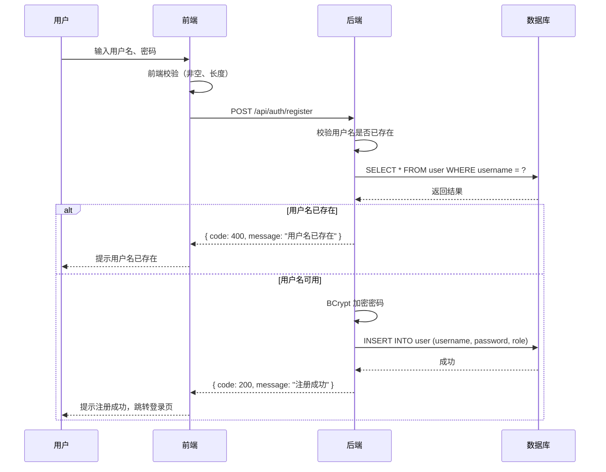
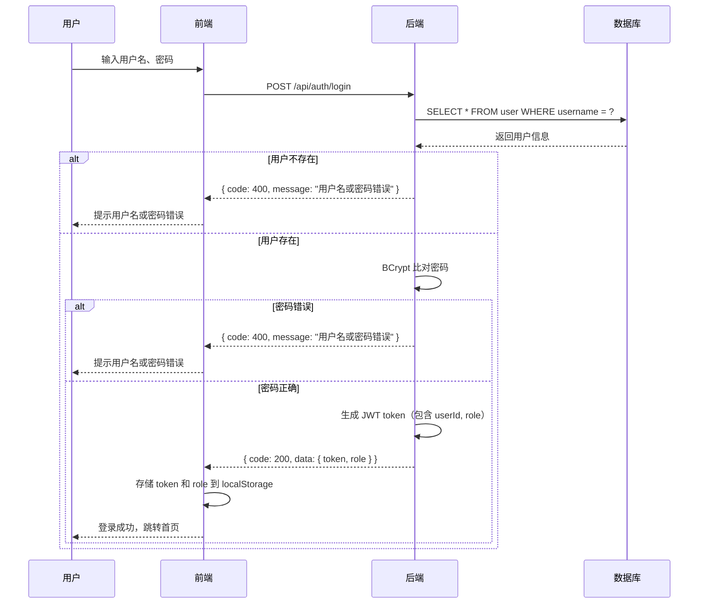
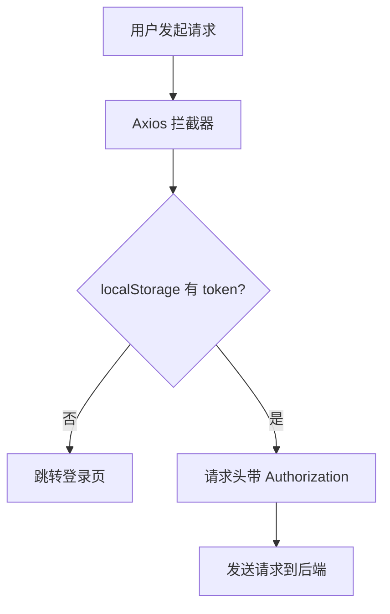
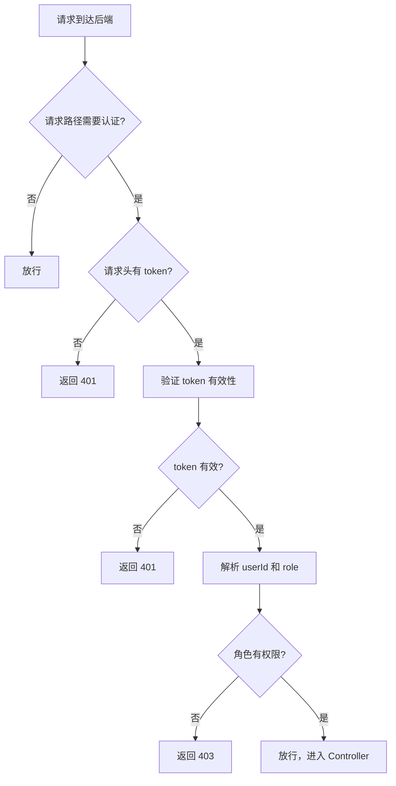
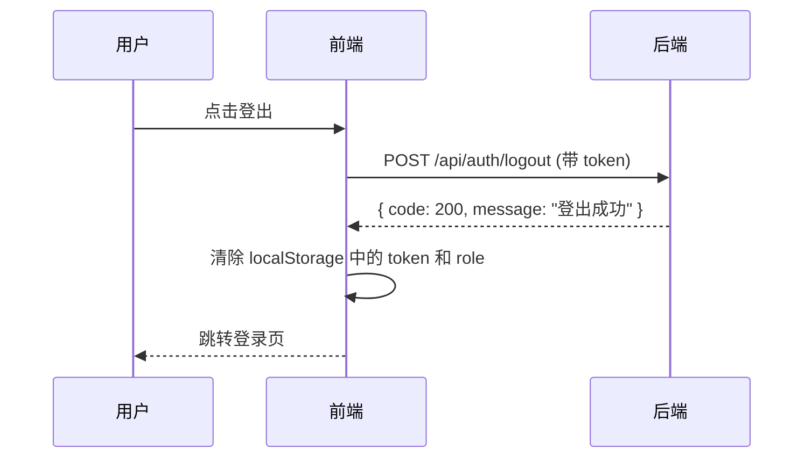
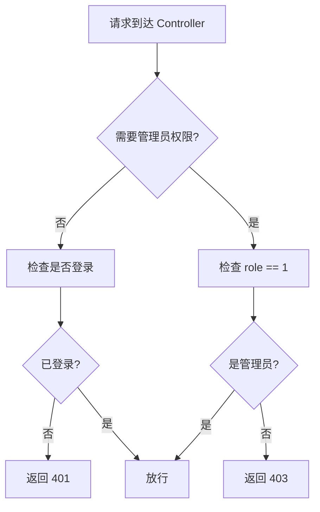

# 用户认证与权限模块

> 版本：1.0 | 更新日期：2026-10-29

---

## 一、模块概述

本模块负责用户注册、登录、登出、JWT 认证、角色权限控制。

---

## 二、用户注册

### 2.1 流程图



### 2.2 业务规则

| 规则 | 说明 |
| --- | --- |
| 用户名唯一 | 数据库 UNIQUE 约束 + 后端校验 |
| 密码加密 | BCrypt 加密后存储，不存明文 |
| 角色默认 | 注册后角色默认为普通用户（role = 0） |
| 管理员不能注册 | 注册接口只能注册普通用户 |

---

## 三、用户登录

### 3.1 流程图



### 3.2 JWT Token 结构

```json
{
  "sub": "userId",
  "role": 0,
  "iat": 1730188800,
  "exp": 1730275200
}
```

**说明**：
- `sub`：用户 ID
- `role`：用户角色（0-普通用户，1-管理员）
- `iat`：签发时间
- `exp`：过期时间（24 小时）

### 3.3 业务规则

| 规则 | 说明 |
| --- | --- |
| 密码比对 | BCrypt 比对，不解密 |
| Token 存储 | 前端存 localStorage |
| 登录态保持 | 刷新页面从 localStorage 读取 token |
| 角色返回 | 登录接口返回 role，前端用于控制菜单显示 |

---

## 四、JWT 认证拦截

### 4.1 前端拦截器



### 4.2 后端过滤器



### 4.3 需要认证的路径

| 路径 | 需要认证 | 需要管理员 |
| --- | --- | --- |
| `/api/auth/register` | ❌ | ❌ |
| `/api/auth/login` | ❌ | ❌ |
| `/api/auth/logout` | ✅ | ❌ |
| `/api/products` |  | ❌ |
| `/api/products/{id}` | ❌ | ❌ |
| `/api/categories` | ❌ | ❌ |
| `/api/cart` | ✅ | ❌ |
| `/api/orders` | ✅ | ❌ |
| `/api/reviews` | ✅ | ❌ |
| `/api/admin/**` | ✅ | ✅ |

---

## 五、用户登出

### 5.1 流程图



### 5.2 业务规则

| 规则 | 说明 |
| --- | --- |
| Token 清除 | 前端清除 localStorage |
| 后续请求 | 不带 token，后端返回 401 |
| 无状态 | JWT 无状态，后端不存储 token |

---

## 六、权限控制

### 6.1 角色权限矩阵

| 功能 | 游客 | 普通用户 | 管理员 |
| --- | --- | --- | --- |
| 浏览首页 | ✅ | ✅ | ✅ |
| 浏览分类 | ✅ | ✅ | ✅ |
| 查看商品详情 | ✅ | ✅ | ✅ |
| 加入购物车 | ❌ | ✅ | ❌ |
| 下单 | ❌ | ✅ | ❌ |
| 查看订单 |  | ✅（仅自己） | ✅（全部） |
| 评价 | ❌ | ✅ | ❌ |
| 后台订单管理 | ❌ | ❌ | ✅ |
| 后台商品管理 | ❌ | ❌ | ✅ |

### 6.2 后端权限校验



### 6.3 数据隔离

| 场景 | 隔离规则 |
| --- | --- |
| 查看订单 | 只能看自己的订单（WHERE user_id = currentUserId） |
| 查看购物车 | 只能看自己的购物车 |
| 评价 | 只能评价自己订单里的商品 |

---

## 七、安全设计

### 7.1 密码安全

| 项 | 说明 |
| --- | --- |
| 加密算法 | BCrypt |
| 存储方式 | 加密后存储，不存明文 |
| 比对方式 | BCrypt 比对，不解密 |

### 7.2 Token 安全

| 项 | 说明 |
| --- | --- |
| 签名算法 | HS256 |
| 密钥存储 | 后端配置文件（不暴露给前端） |
| 过期时间 | 24 小时 |
| 刷新机制 | 暂不做（选做功能） |

### 7.3 接口安全

| 项 | 说明 |
| --- | --- |
| 认证方式 | JWT Bearer Token |
| 权限校验 | 后端拦截器，不依赖前端 |
| 数据隔离 | SQL 查询带 user_id 条件 |

---

## 八、异常处理

### 8.1 常见异常

| 异常 | 状态码 | 提示信息 |
| --- | --- | --- |
| 用户名已存在 | 400 | "用户名已存在" |
| 用户名或密码错误 | 400 | "用户名或密码错误" |
| 未登录 | 401 | "未登录，请先登录" |
| 无权限 | 403 | "无权限访问" |
| Token 过期 | 401 | "登录已过期，请重新登录" |

### 8.2 前端处理

| 状态码 | 处理方式 |
| --- | --- |
| 401 | 清除 token，跳转登录页 |
| 403 | 提示无权限，返回上一页 |
| 400 | Toast 提示错误信息 |
| 500 | Toast 提示"系统异常" |
