# 全局业务流程

> 版本：1.0 | 更新日期：2026-10-29

---

## 一、核心业务流程

### 1.1 购物主链路

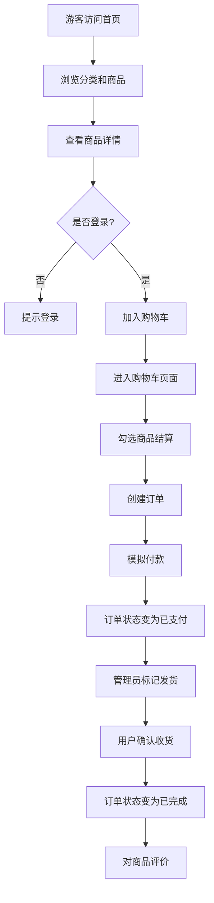

---

### 1.2 订单状态流转

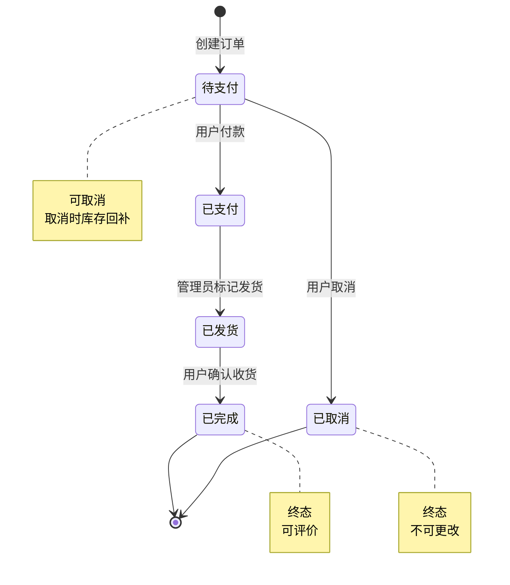

---

### 1.3 库存扣减与回补

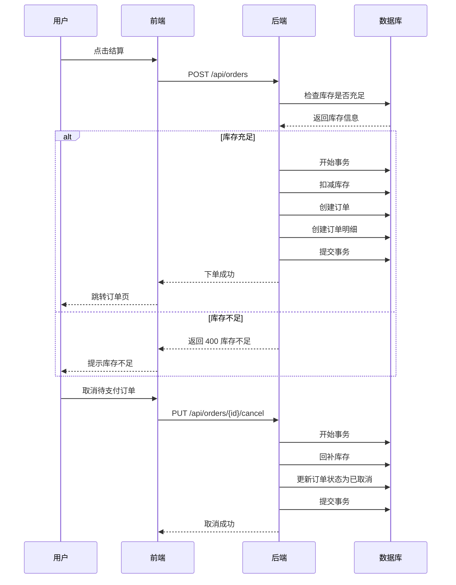

---

## 二、角色权限流程

### 2.1 游客流程

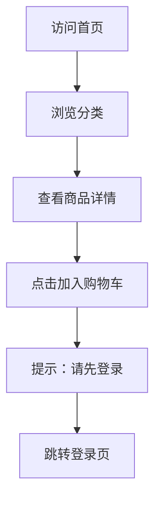

### 2.2 普通用户流程

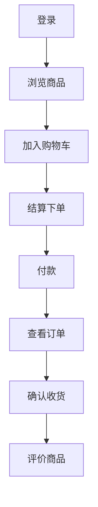

### 2.3 管理员流程

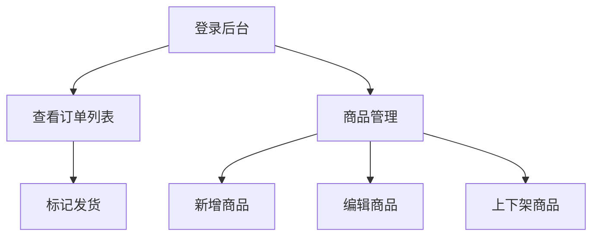

---

## 三、商品上下架影响

### 3.1 下架流程

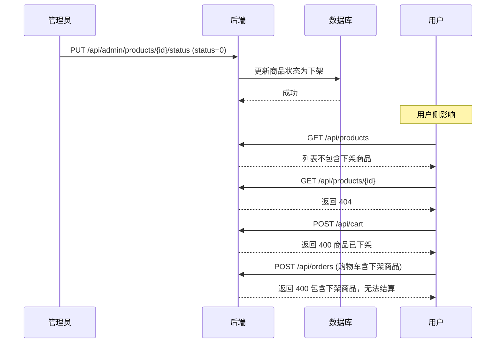

---

## 四、评价流程

### 4.1 评价前置条件

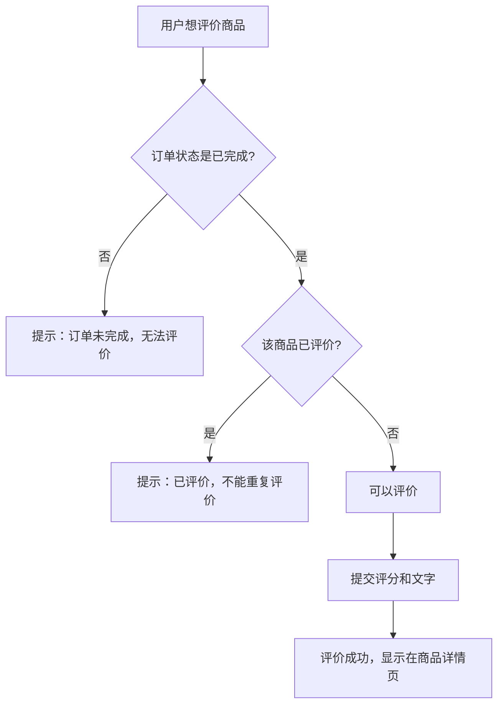

---

## 五、数据一致性保证

### 5.1 事务场景

| 场景 | 事务操作 | 失败处理 |
| --- | --- | --- |
| 下单 | 扣库存 + 写订单 + 写订单明细 | 全部回滚 |
| 取消订单 | 回补库存 + 更新订单状态 | 全部回滚 |
| 确认收货 | 更新订单状态 | 回滚 |

### 5.2 价格快照机制

```mermaid
graph LR
    A[商品表 price] -->|下单时| B[订单明细 unit_price]
    B -->|后续| C[商品改价]
    C -.不影响.-> B

    Note over B: 订单明细存快照<br/>历史订单金额不变
```

---

## 六、异常处理流程

### 6.1 未登录访问

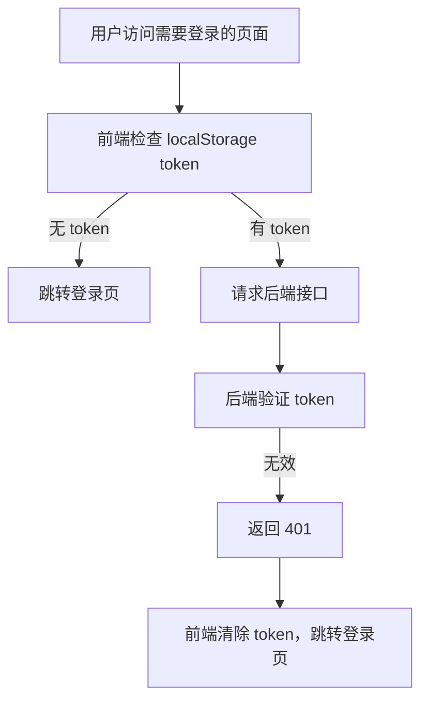

### 6.2 无权限访问

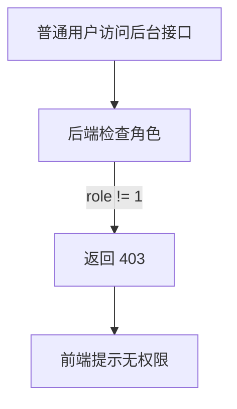

### 6.3 库存不足

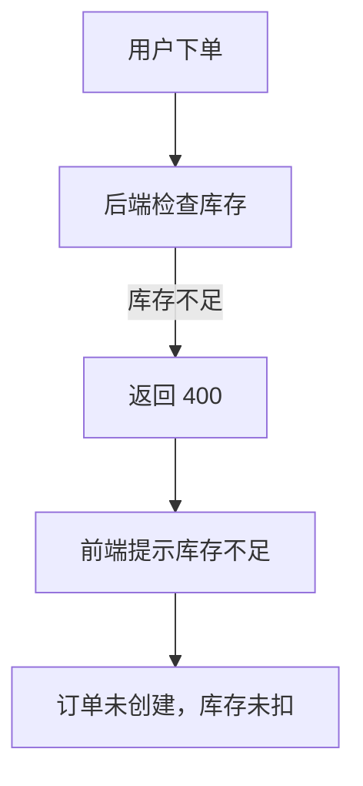
